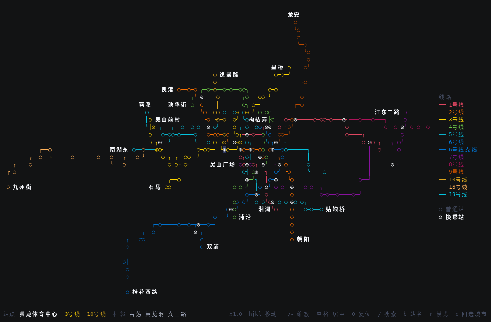

[English](README_EN.md) | 中文

# metro-tui

终端里的地铁线路图:`ratatui` + `crossterm` 画的**箱线字符**地图,一条线路一种真彩色。站序与坐标
来自人工整理的站序表与 OpenStreetMap;同一份数据有**地理视图**(默认)和**示意图**两种画法。



*杭州,默认的地理视图:方向键挪站、缩放、拼音搜索、聚焦线路、沿线跳站、切换示意图。*

## 特性

- **默认按真实经纬度画**;`--schematic`(或按 `r`)切示意图。
- **站序就是数据**:`J`/`L` 下一站、`H`/`K` 上一站,只按线路自己的站序,与屏幕方向和地理方位无关。
- **方向键按屏幕几何**:挑那个方向上最近、且正对着的那一站。
- **搜索**:中文、拼音(`wulin`)、首字母(`wlgc`)、线路号(`/1`)。
- **鼠标**:点站、按住拖动平移、滚轮缩放、`Ctrl`+滚轮平移。
- **多城市**:启动列表选择,`--city <slug>` 直接进;加城市不用重新编译。
- **无头渲染**:`--dump` 输出一帧真彩 ANSI。
- **依赖极少**:只有 `ratatui`、`crossterm`、`unicode-width`,运行时不联网、不用数据库。

## 安装

预编译二进制(x86_64 Linux,glibc 与静态 musl)在 [releases 页面](https://github.com/mixsoulgithub/metro-tui/releases/latest):

```bash
curl -L https://github.com/mixsoulgithub/metro-tui/releases/latest/download/metro-tui-x86_64-unknown-linux-musl.tar.gz | tar xz
install -m755 metro-tui ~/.local/bin/          # 或者放到 PATH 里任意位置
metro-tui --city hangzhou
```

- **Homebrew**(Linux x86_64,静态二进制):`brew install mixsoulgithub/tap/metro-tui`
- **conda / micromamba**:recipe 在 `packaging/conda/meta.yaml`,自己 `conda build` 后传到个人频道,
  再 `conda install -c <频道> metro-tui`

从源码装(需要 Rust,不需要 crates.io 账号):

```bash
cargo install --git https://github.com/mixsoulgithub/metro-tui
cargo build --release                      # 或者 clone 下来自己编
```

## 构建与运行

需要 Rust(edition 2021)和支持真彩的 UTF-8 终端。

```bash
cargo build --release
./target/release/metro-tui                # 先出选城市界面
./target/release/metro-tui --city chengdu # 直接进成都
```

整幅图约 97 km x 51.5 km,200x50 左右正好用满。

支持平台:Linux x86_64(动态 glibc 与静态 musl)、macOS arm64/x86_64、Windows x86_64
(能编译、也随版本发布,但还没在 Windows 上实测过)。

## 命令行

```
--city <slug>  直接进某座城市
--file <path>  读取线路图 .dot
--dump         渲染一帧(ANSI)后退出,配合 --size
--size <WxH>   --dump 的画布大小(默认 200x50)
--labels       一上来就标出所有站名(等于按 b)
--schematic    按示意图画(默认是地理视图,r 切换)
--real         按真实经纬度画(现在的默认,保留兼容)
--at <站名>    开局把光标停在那一站
--find <词>    开局就搜一遍(站名/拼音/首字母/线路号)
```

## 键位

| 键 | 作用 |
| --- | --- |
| `h j k l` / 方向键 | 那个方向上最近、正对着的一站(屏幕距离 + 2 倍侧偏,45 度锥内);聚焦某条线时线上站容忍更大距离(`:cycle` 可调) |
| `H K` / `J L` | 沿线上一站 / 下一站 —— 只按线路自己的站序,和地理方位无关。多条线都能走时弹列表(数字或 `j`/`k`,回车) |
| `+` `-` `0` | 放大 / 缩小 / 复位整幅图 |
| `空格` `z` | 把光标那一站挪到画面正中 |
| `f` | 把聚焦的线路(或当前站那条线)铺满画面 |
| `b` | 开关站名标注 |
| `/` | 搜站名 / 拼音 / 首字母;纯数字高亮那条线 |
| `5l` `3j` | 数字前缀:一次挪好几站 |
| `Ctrl-d` `Ctrl-u` | 半屏往下 / 往上跳 |
| `Ctrl-o` `Ctrl-i` / `Tab` | 回到上一个 / 下一个跳过的站 |
| `n` `N` | 下一个 / 上一个命中 |
| `V` | 聚焦当前站的线路(再来一次取消) |
| `r` | 地理视图 ↔ 示意图 |
| `?` | 键位速查 |
| `:` | 调试:`:cycle <倍数>` 同线容忍度,`:side <倍数>` 侧偏权重,`:cycle auto` 复位 |
| 鼠标 | 点站跳转、按住拖动平移、滚轮缩放、`Ctrl`+滚轮平移(tmux 里要 `set -g mouse on`) |
| `q` / `esc` | 回选城市界面;在那里按才退出 |

光标站是实心的(`●`,换乘站 `◉`),在亮白和红色之间按约 75 下/分的节奏闪。

## 两种画法

**地理视图**(默认):按经纬度等距圆柱投影,纵向按"一格高约等于两格宽"修正 —— 位置是真的,
站密的地方会挤在一起。

**示意图**(`--schematic` / `r`):从真实坐标出发做确定性放松(相邻站弹簧、方向吸附到横竖 45 度、
按线路拉直连着三站、互相推开至少一格),再取整到格子并收尾(任意两站至少隔一格)。相对方位保留;
200x50 的窗口是"放大"铺满,不是压着塞进去。

画法规则:`○` 普通站、`◎` 换乘站、颜色即线路色;只用 `─ │ ╭ ╮ ╯ ╰` 走线;两条线在非站点处交叉时
一条从另一条下面过(断一格),所以 `┼` 这类字形只出现在站点上;一格一色,冲突时**光标所在站的线路
优先**;端点站常驻站名,`b` 强制全标。

## 数据

站序存在表里:`docs/*.md`(人工整理)→ `tools/csv2dot.py` → `docs/*.dot`(杭州走
`tools/md2dot.py`,坐标从 OSM 取、缺的按线路插值)。`.dot` 可以编进程序(`include_str!`),也可以
直接放进 `docs/` 或用户数据目录(`$XDG_DATA_HOME/metro/cities`,默认 `~/.local/share/metro/cities`)
—— 启动时两处都会扫,所以加城市不用重新编译。

任意城市也能从 OSM 生成:

```
python3 tools/build_cities.py --all      # 抓取 + 建图,可断点续跑
python3 tools/build_cities.py --city wuhan
```

加城市只改 `tools/cities.py` 里的表(slug / 中文名 / OSM network 标签 / bbox);`networks` 留空
表示"bbox 内的 `route=subway` 关系全要"。抓取脚本启动时先探一遍 Overpass 镜像,失败换镜像并退避;
站点优先按线路 stop 成员的节点 id 取,整城查只作兜底。本机有代理会从标准环境变量自动识别。

数据来源:站点坐标与线路颜色来自 OpenStreetMap(`route=subway` 关系、`station=subway` 节点),
(c) OpenStreetMap contributors,**ODbL**;拼音表取自
[pypinyin](https://github.com/mozillazg/python-pinyin)(MIT)。

## 已知取舍

- 一条线不穿过别的站、也不把自己的笔画围成环;杭州那几座城里仍有 3 处小圈,是最后一段直线封的口。
- 市中心站距常不到一格,放大或开大窗口。
- 换乘站若各线各有自己的 OSM 节点,按名字与邻近合并成一个。
- `○ ◎ ─` 的东亚宽度是"不确定"的:宽字符终端 + CJK 字体可能画成两格宽,整幅图会错位。

## 许可

代码:MIT([LICENSE](LICENSE))。地图数据:(c) OpenStreetMap contributors,ODbL。
